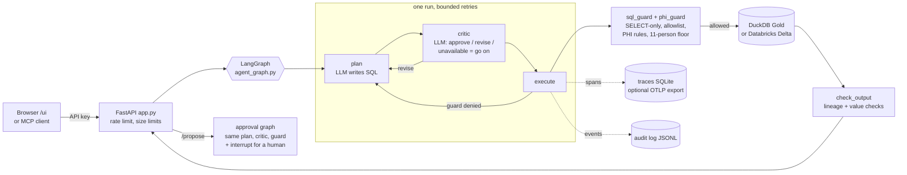

# Architecture

One page: what runs where, how a question is answered, how it scales and where
it breaks, and the main trade-offs. Every number here comes from a committed
measurement; the source is linked next to it.

## The path of one question

- **The guard is the security boundary, not the model.** Every SQL statement,
  from `/query`, `/raw-sql`, `/propose` or MCP, goes through `sql_guard` and
  `phi_guard` before it runs, and the result goes through `check_output` after.
  The critic can only make the agent stricter; it never skips the guard
  (`test_the_guard_still_denies_what_the_critic_approved`).
- **The database connection is locked down too** (security audit item 30): the
  Gold files are opened read only, with no external access, no extension loading, configuration locked, so a
  guard escape still reaches no file or network.
- **Every run is a trace** whose id is the LangGraph thread id: spans hold the
  question, SQL and row counts, never rows.

## How it scales and where it breaks

Measured on **recorded** model answers, so these numbers are this stack's cost,
not the model's ([`docs/benchmarks.md`](benchmarks.md), backlog item 20).

| | 1 user | 5 users | 20 users |
|---|---|---|---|
| p50, before item 20 | 26.2 ms | 120.1 ms | 494.3 ms |
| p50, after item 20 | 16.3 ms | 89.7 ms | 360.1 ms |
| throughput, before | 38.0 req/s | 41.0 req/s | 40.2 req/s |
| throughput, after | 59.5 req/s | 55.5 req/s | 53.7 req/s |

What these show:
1. **Throughput is flat as users grow; latency grows with them.** That is a
   queue: one process.
2. **The global lock was not the cap.** Removing it changed nothing measurable
   on its own. The tracer was (a new SQLite connection and full-sync commit per
   span); one long-lived WAL writer took ~40 to ~55 req/s.
3. **What is left is Python CPU in one process** (graph, SQL parsing, PHI
   checks under the GIL). More throughput needs more processes, which needs
   shared state first: backlog items 19 (state in Postgres) and 21 (two
   replicas).

Where it breaks, in the order you would hit it:
- **The model provider, long before this code.** On the free Gemini tier a
  plan call takes seconds and the daily quota runs out during a full eval
  sweep. Runs that call the model are capped at `MAX_CONCURRENT_RUNS` (4); a
  caller who waits over 15 s gets 429 with `Retry-After`.
- **One Render free instance**: 512 MB, sleeps when idle (first request waits
  for it to wake), and no lasting disk, so traces, cache and audit in SQLite
  reset on a redeploy. The API image idles at about 110 MiB (README, "Run it").
- **One DuckDB file per instance.** Two replicas need either Databricks SQL as
  the shared backend (verified for parity once) or a read-only copy per
  replica (item 21).
- **The guard is a parser.** It is a patch list over SQL shapes, hardened by
  adversarial reviews. Known open gaps on `main`: a date grouped below the year
  as a hidden key (a strict xfail in `tests/security/test_phi_guard.py`),
  cross-query differencing (accepted residual risk, [PLAN_v2 §0.4](PLAN_v2.md)),
  row-multiplying joins, set-returning functions and seeded sampling, whose fix
  is open in [#116](https://github.com/erjonb19/governed-clinical-agent/pull/116)
  waiting on its eval comparison; and key-joined self-joins, which stay open
  after #116 (an owner's decision, backlog item 71 on that branch). The planned
  answer is a de-identified layer enforced by the database
  ([PLAN_v2 §0.6](PLAN_v2.md)).

## Main trade-offs

| Choice | Why | Cost | Decision |
|---|---|---|---|
| Graph with a critic, not single-shot | Self-correction on guard denials and bad plans | One extra model call per attempt; on today's banks both paths score 100% | [PLAN_v2](PLAN_v2.md) D2, §0.3 |
| Critic fails open to the guard | A provider blip should not block every query; security stays with the guard | A bad plan can reach the guard unreviewed | PLAN_v2 D4 |
| Fixed, reviewed SQL for the Overview findings | No invented numbers, $0 | Only the questions someone wrote in advance | PLAN_v2 D7 |
| PHI rules in the guard, aggregate-only FHIR, 11-person floor | Patient-level data never leaves, even to a key holder | Some legitimate questions are refused; accuracy cost measured per PR | PLAN_v2 §0.4 |
| Home-grown tracing in SQLite, optional OTLP | Runs on Render free with no second service | A plainer viewer; Phoenix (530 MB idle) only locally; hosted export (item 12) waits on the owner's Render settings | PLAN_v2 D3, backlog items 2 and 12 |
| Recorded answers in the push gate | Every push tests the guard and scoring at $0 | The replayed gate does not test a model; a 3-case live Groq check and the nightly do | Backlog item 13 |
| Free tiers only | $0 project | Quota and cold starts shape every number above | CLAUDE.md, ground rules |

## Where to look next

- A three-minute tour to record: [`docs/WALKTHROUGH.md`](WALKTHROUGH.md).
- The security design: [`docs/DESIGN.md`](DESIGN.md) and the audit
  [`docs/SECURITY_AUDIT_2026-11-10.md`](SECURITY_AUDIT_2026-11-10.md).
